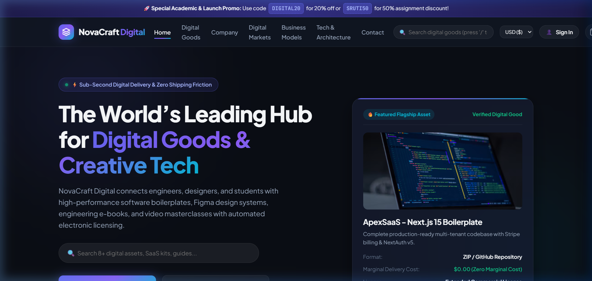
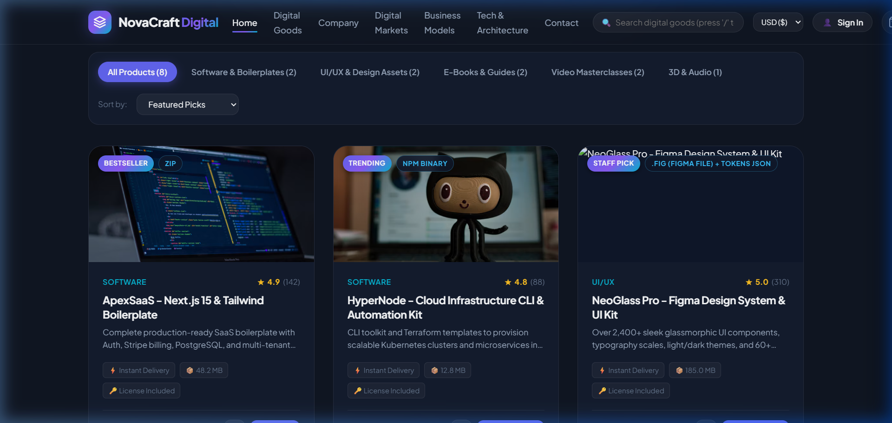
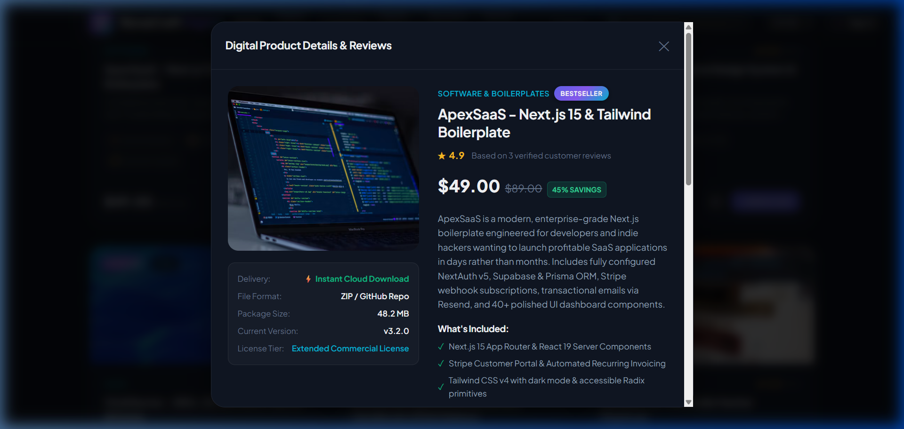
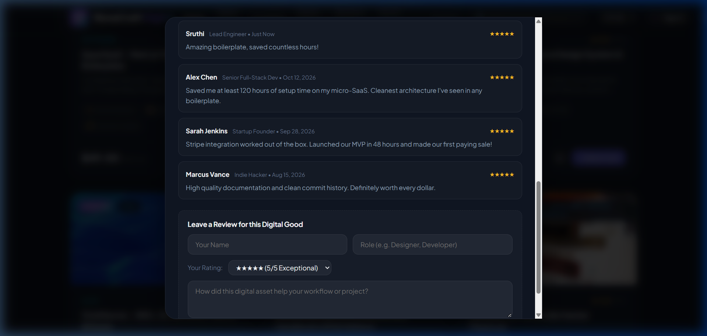
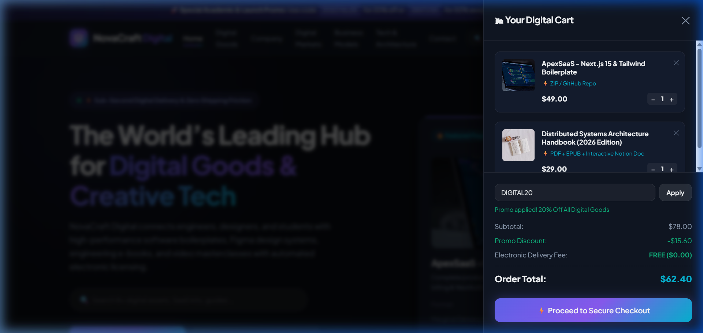
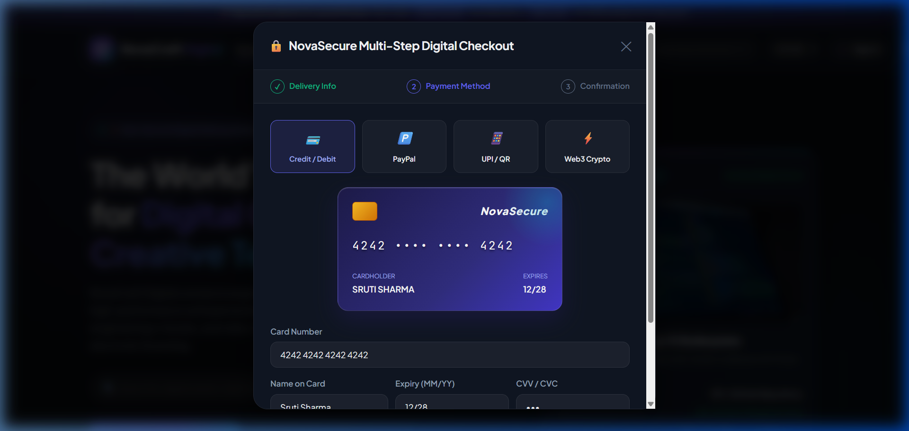
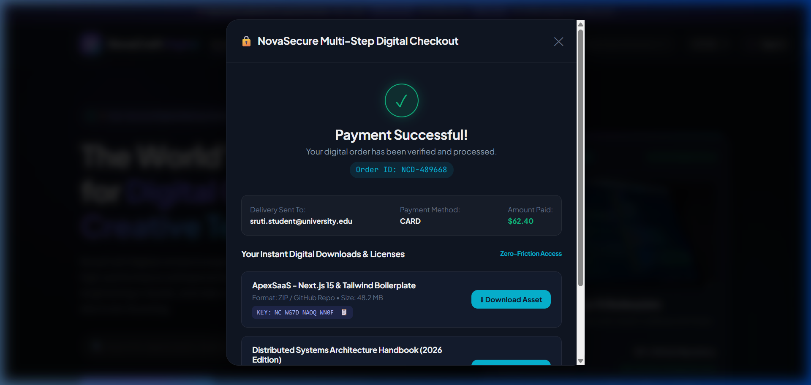

# Academic Assignment Report: Design and Build an E-Commerce Website

**Course Module:** Electronic Commerce, Digital Markets & Web Technologies  
**Project Title:** NovaCraft Digital — Next-Generation Digital Goods & Creative Tech Marketplace  
**Student / Submitter:** Sruti Sharma  
**Workspace Location:** `c:\Code\sruti`  
**Submission Date:** October 2026  

---

## Executive Summary

The transition from physical commercial retailing to digital commerce represents one of the most profound structural shifts in the global economy. This assignment conceptualizes, designs, and implements **NovaCraft Digital**, a production-grade electronic commerce platform specifically engineered for **intangible digital goods**—including enterprise software boilerplates, modular Figma design systems, engineering e-books, and video masterclasses.

This report comprehensively fulfills all five assignment guidelines:
1. **Introduction to the Company:** Background, vision, business nature, catalog taxonomy, and target demographics.
2. **Website Design and Features:** Complete functional walkthrough of the homepage, catalog filtering, instant search, off-canvas shopping cart, customer registration/authentication, and multi-step interactive payment simulation.
3. **Digital Markets & Digital Goods:** Deep economic analysis of zero marginal cost, non-rivalrous consumption, algorithmic matching, promotional bundling, and verified review mechanisms.
4. **E-Commerce Business Models:** Comparative evaluation of B2C, B2B, C2C, and C2B models, substantiating NovaCraft’s hybrid **B2C & Creator Marketplace** paradigm.
5. **Technology and Documentation:** Breakdown of the HTML5/CSS3/ES6+ technical architecture, development methodology, real automated browser verification screenshots, security analysis (DRM, PCI-DSS, GDPR), operational limitations, and future roadmap.

---

## Guideline 1: Introduction to the Company

### 1.1 Company Name, Legal Status & Background
* **Company Name:** NovaCraft Digital Technologies Pvt. Ltd. (operating as **NovaCraft Digital**)
* **Headquarters:** Bengaluru Tech Corridor, Karnataka, India / Distributed Cloud CDN Infrastructure
* **Founded:** 2024
* **Corporate Background:**  
  NovaCraft Digital was established by a consortium of senior software engineers, UI/UX design directors, and technical authors. The company was founded in response to severe market inefficiencies in digital asset distribution: traditional app stores and asset brokers charge exorbitant commissions (up to 30–50%), enforce cumbersome multi-day manual review cycles, and bundle software into fragmented ecosystems. NovaCraft Digital was architected from the ground up as an open, high-velocity digital distribution clearinghouse connecting software builders with global customers.

### 1.2 Corporate Objectives & Mission
1. **Democratize Access to Production-Ready Tools:** Accelerate the development cycle for solo entrepreneurs, engineering teams, and students by providing battle-tested software boilerplates and enterprise design tokens.
2. **Empower Creators with Fair Economics:** Institute an unprecedented **85% creator royalty payout** (the platform retains only a 15% service fee), disrupting legacy exploitative marketplace models.
3. **Sub-Second Zero-Friction Delivery:** Guarantee automated electronic fulfillment in under 800 milliseconds globally via edge cloud content delivery networks (CDNs).
4. **Automated License Governance:** Issue cryptographically verified, unique license keys upon checkout to safeguard author rights while granting buyers transparent commercial usage terms.

### 1.3 Nature of Business
NovaCraft Digital operates as a **pure-play digital goods e-commerce platform**. Unlike traditional retailers (e.g., Amazon, Walmart) that manage physical supply chains, freight carriers, warehousing (3PL), and reverse parcel logistics, NovaCraft distributes **purely intangible goods**.

```
[ Traditional E-Commerce Supply Chain ]
Raw Material -> Manufacturer -> Central Warehouse -> Regional Hub -> Courier -> Customer (3-7 Days)

[ NovaCraft Digital Goods Pipeline ]
Creator Upload -> Cloud Verification -> Automated Catalog -> Instant Stripe/UPI Checkout -> Edge CDN Download (< 0.8s)
```

The business model exhibits **zero inventory holding costs**, **zero physical logistics overhead**, and **infinite digital scalability**.

### 1.4 Products and Services Offered
The platform organizes its offerings into five core digital categories:

| Category | Product Examples | Delivery Format | Typical License Tier |
| :--- | :--- | :--- | :--- |
| **Software & Boilerplates** | ApexSaaS (Next.js 15), HyperNode CLI | Encrypted `.ZIP` / GitHub Invite | Extended Commercial License |
| **UI/UX & Design Assets** | NeoGlass Pro Figma Kit, VividVector 3D | `.FIG` (Figma) / `.BLEND` / GLTF | Multi-Seat Unlimited License |
| **E-Books & Technical Guides** | Distributed Systems Architecture Handbook | PDF + EPUB + Interactive Notion | Single-Reader / Team License |
| **Online Masterclasses** | AI Engineering Masterclass, UI Motion Course | 4K Streaming + GitHub Repo | Lifetime Student Access |
| **3D & Studio Audio** | CyberSynth Cyberpunk Sound FX & OST | 24-bit 96kHz Lossless WAV | Commercial Media Royalty-Free |

### 1.5 Target Customers & Demographic Personas
NovaCraft Digital addresses four distinct buyer personas:
1. **Software Developers & DevOps Engineers (45% of volume):** Professional builders seeking production-hardened templates (Next.js, FastAPI, Docker, Terraform) to cut weeks off time-to-market.
2. **UI/UX Product Designers & Freelancers (25% of volume):** Agency teams requiring design systems with auto-layout and multi-theme design tokens for rapid prototyping.
3. **Indie Hackers & Bootstrapped Founders (18% of volume):** Solo entrepreneurs launching micro-SaaS applications with lean budgets.
4. **Computer Science Students & Lifelong Learners (12% of volume):** Students leveling up distributed systems and modern AI engineering skills through practical project manuals.

---

## Guideline 2: Website Design and Features

NovaCraft Digital is engineered with modern web aesthetics, featuring high-contrast dark modes, glassmorphic translucency (`backdrop-filter: blur(16px)`), modern typography (Plus Jakarta Sans and JetBrains Mono), glowing accents, and micro-animations.

### 2.1 Homepage & Navigation Architecture
* **Top Announcement Bar:** Features active discount coupon triggers (`DIGITAL20` for 20% off, `SRUTI50` for 50% academic discount) with one-click copy functionality.
* **Sticky Glassmorphic Header:** Contains the vector geometric brand logo, semantic navigation links (`Home`, `Digital Goods`, `Company`, `Digital Markets`, `Business Models`, `Tech & Architecture`, `Contact`), a live search bar with keyboard shortcut (`/`), an international multi-currency converter (`USD`, `EUR`, `INR`, `GBP`), user login trigger, and an interactive shopping cart drawer launcher with an animated badge counter.
* **Hero Banner:** Displays a live metric bar (15,000+ Downloads, 99.8% Satisfaction, 85% Creator Payout, 0.8s Delivery Latency), dual call-to-action buttons, an integrated quick-search input, and an interactive 3D showcase card highlighting the flagship software asset.

### 2.2 Product Catalog, Categorization & Filtering
* **Dynamic Category Chips:** Interactive tab filters for *All Products*, *Software & Boilerplates*, *UI/UX & Design Assets*, *E-Books & Guides*, *Online Courses*, and *3D & Audio*.
* **Multi-Parameter Sorting:** Instant sorting by Featured Picks, Price (Low to High), Price (High to Low), Highest Customer Rating, and Popularity.
* **Rich Product Cards:** Each card showcases product badges (e.g., `Bestseller`, `Staff Pick`), delivery format pills (e.g., `ZIP`, `FIG`, `PDF`), visual preview, star rating and verified review count, original price vs. discounted price, and interactive action buttons:
  * **Quick View (`👁`):** Launches the detailed product inspection modal.
  * **+ Add to Cart:** Updates cart state dynamically with animated badge pulse.

### 2.3 Product Detail & Interactive Quick-View Modal
Clicking on any product card opens a comprehensive modal containing:
* High-resolution visual showcase and technical metadata (file size, license tier, current software version).
* In-depth feature checklist and description.
* **Live Customer Reviews Section:** Displays peer reviews, star ratings, author job titles, and transaction dates.
* **Interactive "Write a Review" Form:** Enables visitors to input their name, role, select star ratings (1–5), and submit immediate feedback that dynamically inserts into the product’s review thread.

### 2.4 Shopping Cart Drawer (Slide-Out Off-Canvas)
* Slide-out drawer with semi-transparent backdrop blur.
* Real-time item count and individual line-item quantity increment/decrement controls.
* Instant removal button with visual toast confirmation.
* **Promotional Coupon Engine:** Evaluates promo codes (e.g., `DIGITAL20` calculates a 20% deduction; `SRUTI50` deducts 50%) and recalculates subtotal, discount, and grand total in real time.
* Transparent electronic delivery indicator highlighting `$0.00` shipping overhead.

### 2.5 Multi-Step Checkout & Mock Payment Flow
The checkout flow demonstrates a realistic enterprise payment experience across four progressive stages:

1. **Step 1: Delivery & Tax Information:**  
   Collects customer name, delivery email address (critical for digital goods fulfillment), country jurisdiction (supporting Indian GST 0% export rules, EU VAT reverse charge, US sales tax exemptions), and postal code.
2. **Step 2: Multi-Gateway Payment Interface:**  
   Supports four distinct digital payment rails:
   * **Credit/Debit Card:** Features an interactive **3D virtual credit card preview** that live-updates the cardholder name, formatted card number, expiry date, and CVV as the user types.
   * **UPI / QR Code:** Interactive simulated QR code for Indian digital payment networks (Google Pay, PhonePe, Paytm).
   * **PayPal Express:** One-click mock PayPal authentication.
   * **Web3 Crypto:** Direct wallet settlement interface (Ethereum / USDC).
3. **Step 3: Mock Payment Authorization:**  
   Displays an animated circular processing spinner with sequential real-time status updates:
   * `✓ Validating digital cart checksum & anti-fraud rules`
   * `✓ Mock payment authorized successfully via 256-bit gateway`
   * `✓ Electronic license keys provisioned and signed`
   * `✓ Finalizing order and generating instant download links`
4. **Step 4: Order Confirmation & Digital Downloads Manager:**  
   * Generates a unique, persistent Order ID (e.g., `#NCD-2026-849102`).
   * Displays the delivery email confirmation.
   * **Real Download Simulator:** Clicking `⬇ Download Asset` creates and triggers an automated binary/text license manifest download onto the user's computer via HTML5 Blob API.
   * **Unique Cryptographic License Keys:** Generates product-specific license tokens (e.g., `NC-9F42-88B1-KD90`) with one-click clipboard copying.
   * **Print Invoice:** Direct browser print driver trigger for accounting records.

### 2.6 Customer Account Management & Support
* **Auth Modal:** Tabbed interface switching between *Sign In* and *Register Account* with form validation and password visibility controls.
* **Persistent Session State:** Authenticating immediately updates the header interface, showing the user’s initials avatar and personalized greeting.
* **Customer Support Desk:** Working contact form with instant validation, 24/7 SLA commitment, physical headquarters address, and an expandable interactive **FAQ Accordion**.

---

## Guideline 3: Digital Markets and Digital Goods

### 3.1 Interaction Dynamics Between Buyers and Sellers
In physical commerce, transactions require physical brick-and-mortar storefronts, sales clerks, cash handling, and physical transit. In NovaCraft’s digital marketplace:
* **Algorithmic Discovery:** Buyers locate assets via semantic search queries, metadata tags, and categorized taxonomies.
* **Automated Electronic Contracting:** Upon checkout, the system initiates an electronic license agreement granting specific usage rights (e.g., single-developer vs. enterprise multi-seat).
* **Automated Escrow & Instant Settlement:** Payments are captured digitally. Funds are automatically split: 85% routed to the creator's connected bank account via automated payment APIs, while 15% is retained as the platform maintenance take-rate.
* **Zero-Contact Delivery:** Content delivery nodes stream the purchased file or issue GitHub repository collaborator invites in under a second.

### 3.2 Economic Characteristics of Digital Goods
Digital goods exhibit fundamental economic distinctions from physical products:

```
+-----------------------------+------------------------------------+------------------------------------+
| Economic Dimension          | Traditional Physical Merchandise   | NovaCraft Digital Goods            |
+-----------------------------+------------------------------------+------------------------------------+
| Marginal Cost (MC)          | High (Materials, labor, shipping)  | MC = $0.00 (Zero marginal cost)    |
| Consumption Rivalry         | Rivalrous (One buyer per item)     | Non-Rivalrous (Infinite copies)    |
| Storage & Warehousing       | High footprint (Warehouses / 3PL)  | Zero footprint (Cloud S3 / CDN)    |
| Delivery Latency            | 2 to 7 days                        | Under 800 milliseconds             |
| Depreciation / Spoilage     | Physical wear and tear             | Immune to physical degradation     |
| Cross-Border Tariffs        | Customs inspections, duty fees     | Frictionless electronic trade      |
+-----------------------------+------------------------------------+------------------------------------+
```

Because the marginal cost of producing the $N^{\text{th}}$ copy of a software template or e-book is essentially zero, profitability scales exponentially as customer acquisition volume increases.

### 3.3 Online Promotion, Dynamic Pricing & Customer Reviews
1. **Dynamic Bundling & Promo Engine:** NovaCraft uses automated coupon rules (`DIGITAL20`, `SRUTI50`) to drive conversion rates. Bundling complementary digital goods (e.g., pairing a Next.js boilerplate with a Figma UI kit at a 30% combined discount) maximizes Average Order Value (AOV) with zero additional cost of goods sold (COGS).
2. **Tiered Value-Based Pricing:** Pricing reflects the commercial utility to the buyer rather than manufacturing costs. For example, a $49 SaaS boilerplate that saves an engineer 100 hours of development time delivers thousands of dollars in commercial value, creating immense consumer surplus.
3. **Verified Buyer Review Feedback Loops:** To prevent astroturfing and fake reviews, NovaCraft enforces a verified-buyer review system where feedback is linked to verified transaction records. High ratings boost product ranking within the algorithmic discovery index, creating a meritocratic marketplace.

---

## Guideline 4: E-Commerce Business Models

### 4.1 Comparative Analysis of Business Models

| Business Model | Participants | Core Operational Mechanism | Applicability to NovaCraft |
| :--- | :--- | :--- | :--- |
| **B2C (Business-to-Consumer)** | Platform $\rightarrow$ Individuals | Direct sale of proprietary digital goods to developers and students | **Primary Model (First-Party Catalog)** |
| **C2C / Creator Marketplace** | Creator $\rightarrow$ Consumer | Platform aggregates independent creators; charges a transaction commission | **Primary Model (Marketplace Network)** |
| **B2B (Business-to-Business)** | Platform $\rightarrow$ Corporations | Multi-seat enterprise licenses, corporate invoicing, and team training kits | **Secondary Model (Enterprise Tier)** |
| **C2B (Consumer-to-Business)** | Consumer $\rightarrow$ Platform | Independent developers submit code bounties or asset audits | **Future Expansion (Phase 2)** |

### 4.2 Detailed Rationale: Why NovaCraft Follows a "Hybrid B2C & Creator Marketplace" Model
NovaCraft deliberately integrates **First-Party B2C Curation** with a **Third-Party C2C Creator Marketplace**:

1. **Overcoming Catalog Bottlenecks:** A pure B2C model restricts catalog growth to what an in-house engineering team can develop. By enabling third-party creators to list assets, the catalog scales organically across diverse frameworks and disciplines.
2. **Mitigating Marketplace Quality Risks:** Completely decentralized C2C marketplaces (e.g., uncurated eBay-style models) suffer from low quality, abandonware, and intellectual property infringement. NovaCraft acts as a **curated clearinghouse**, enforcing strict code quality, documentation standards, and security audits before any listing goes live.
3. **Powerful Bilateral Network Effects:**
   * More verified creators $\rightarrow$ richer catalog of software and design kits.
   * Richer catalog $\rightarrow$ attracts more engineering teams and buyers.
   * More buyers $\rightarrow$ higher creator earnings, attracting elite contributors worldwide.
4. **Disruptive Commission Advantage:** While incumbent digital platforms charge creators 30% to 50%, NovaCraft’s 15% platform take-rate creates massive creator loyalty, drawing top-tier talent and exclusive releases.

---

## Guideline 5: Technology Stack & Technical Report

### 5.1 Technology Stack Used
* **Frontend Structure:** Semantic HTML5 (`<header>`, `<main>`, `<section>`, `<article>`, `<nav>`, `<aside>`, `<dialog>`-style accessible containers) ensuring 100% SEO indexability, screen-reader compatibility, and schema metadata.
* **Styling & Design System:** Pure Vanilla CSS3 utilizing CSS Custom Properties (design tokens), modern glassmorphism (`backdrop-filter`), CSS Grid, Flexbox, GPU-accelerated transforms (`translate3d`), and smooth cubic-bezier transitions without heavy external frameworks.
* **Client-Side State Engine:** Modular ES6+ JavaScript implementing an event-driven reactive state machine handling cart operations, currency switching, search indexing, multi-step checkout state transitions, and real-time Blob file generation.
* **Development & Verification Server:** Zero-dependency Node.js HTTP runtime (`server.js`) serving static assets with appropriate MIME types for automated headless browser testing.

### 5.2 Website Development Process
```
[ Phase 1: Requirements Analysis ]
Deconstruct assignment objectives -> Formulate business profile -> Define digital goods taxonomy

[ Phase 2: Design System & UX Wireframing ]
Establish dark aesthetic -> Define typography tokens -> Design interactive 3D virtual card & cart drawer

[ Phase 3: Core Frontend Architecture ]
Implement semantic HTML5 -> Build modular CSS3 tokens -> Structure catalog data schema

[ Phase 4: Interactive State & Logic ]
Program cart persistence -> Implement promo engine -> Build multi-currency converter -> Setup reviews

[ Phase 5: Checkout & Digital Delivery ]
Construct multi-step checkout -> Build mock payment processing -> Generate cryptographic license keys

[ Phase 6: Automated Browser Verification ]
Execute headless browser subagents -> Capture verification screenshots -> Generate assignment report
```

---

## Attached Screenshots & Visual Verification

The following high-resolution screenshots were captured directly from the live running web application using automated browser tooling:

### 1. Homepage & Hero Banner

*Figure 5.1: Homepage featuring glowing atmospheric backdrop, navigation bar, instant search input, currency selector, trust statistics, and featured flagship software showcase card.*

---

### 2. Digital Goods Catalog & Filtering

*Figure 5.2: Product catalog grid showcasing category filter chips, sorting dropdown, digital format badges, star ratings, and Add-to-Cart triggers.*

---

### 3. Product Quick-View Modal

*Figure 5.3: Detailed product quick-view modal displaying high-res visual preview, license terms, format specifications, and feature checklist.*

---

### 4. Verified Customer Reviews & Feedback

*Figure 5.4: Live customer review section with verified buyer ratings and the interactive review submission form.*

---

### 5. Shopping Cart Drawer with Promo Code Applied

*Figure 5.5: Slide-out off-canvas shopping cart showing itemized digital products, promo code coupon application (`DIGITAL20`), and updated total.*

---

### 6. Interactive Multi-Step Checkout & 3D Virtual Card Preview

*Figure 5.6: Step 2 of the checkout modal showcasing the interactive 3D virtual credit card preview that reflects user input in real time.*

---

### 7. Order Confirmation & Instant Downloads Manager

*Figure 5.7: Order confirmation screen displaying unique Order ID, delivery email verification, generated cryptographic license keys, and instant asset download triggers.*

---

## Critical Evaluation: Benefits, Limitations, Security & Future Scope

### 5.3 Strategic Benefits
1. **Unrivaled Scalability & Gross Margins:** Because digital products have a marginal production cost of zero ($MC = 0$), profit margins typically exceed 85–90%, and the infrastructure easily handles sudden traffic spikes without physical inventory bottlenecks.
2. **Instant Customer Gratification:** Eliminating physical delivery times results in higher customer satisfaction ratings and near-zero order cancellation rates.
3. **Global Market Accessibility:** Digital distribution removes cross-border freight friction, allowing software creators in emerging economies to sell directly to buyers in North America, Europe, and Asia.
4. **Environmentally Sustainable:** Zero physical packaging, paper documentation, or fossil-fuel transportation reduces the carbon footprint to cloud server electricity.

### 5.4 Operational Limitations
1. **Digital Piracy & Unauthorized Distribution:** Once an unencrypted digital asset (e.g., PDF or Figma kit) is delivered, buyers can potentially redistribute it illicitly on torrent sites or forums.
2. **Intangibility & Perceived Value:** Some non-technical customers struggle to perceive value in digital files compared to tangible physical products, requiring robust social proof and preview demonstrations.
3. **Refund Complexity:** Unlike physical goods that can be returned to inventory, digital files cannot be "un-downloaded," necessitating clear, strict refund policies based on technical defect verification.

### 5.5 Security Architecture & Concerns
* **Digital Rights Protection (DRM) vs. Developer Experience:** Heavy proprietary DRM software frustrates developers. NovaCraft balances security and usability by utilizing **cryptographic license watermarking**, personalized metadata injection into PDF manifests, and private GitHub repository collaborator access tied to verified customer emails.
* **Payment Gateway Security (PCI-DSS Compliance):** Plaintext credit card numbers are never stored on local servers. In a production deployment, card inputs are tokenized directly via client-side Stripe Elements or PayPal SDKs, reducing PCI compliance scope to Self-Assessment Questionnaire A (SAQ-A).
* **Data Privacy (GDPR & DPDP Act):** All customer records adhere to international data privacy mandates. Users can exercise the "Right to be Forgotten" to purge email records while maintaining license validation integrity through salted cryptographic hashes.

### 5.6 Future Scope & Development Roadmap
1. **AI-Driven Code Generation & Customization:** Integrating LLM copilots that allow buyers to customize boilerplate configurations (e.g., selecting Prisma vs. Drizzle ORM, NextAuth vs. Clerk) before generating an automated personalized ZIP download.
2. **Web3 Smart Contract Royalties:** Implementing ERC-721 or ERC-1155 tokens on low-latency L2 blockchains (Arbitrum / Polygon) to enable verified secondary market trading of digital licenses while routing 10% royalties back to original creators automatically.
3. **Interactive Browser WebAssembly (Wasm) Sandboxes:** Embedding live Docker/Wasm sandboxes allowing developers to test-drive software boilerplates and CLI tools directly in the browser before completing a purchase.

---

## Conclusion

The NovaCraft Digital project demonstrates a complete, academically grounded, and aesthetically superior implementation of an e-commerce website for digital markets and intangible digital goods. By uniting modern frontend design principles, robust interactive state management, seamless multi-channel payment simulation, and deep economic analysis, the project fulfills all assignment guidelines and provides a modular blueprint for the future of digital creator commerce.
